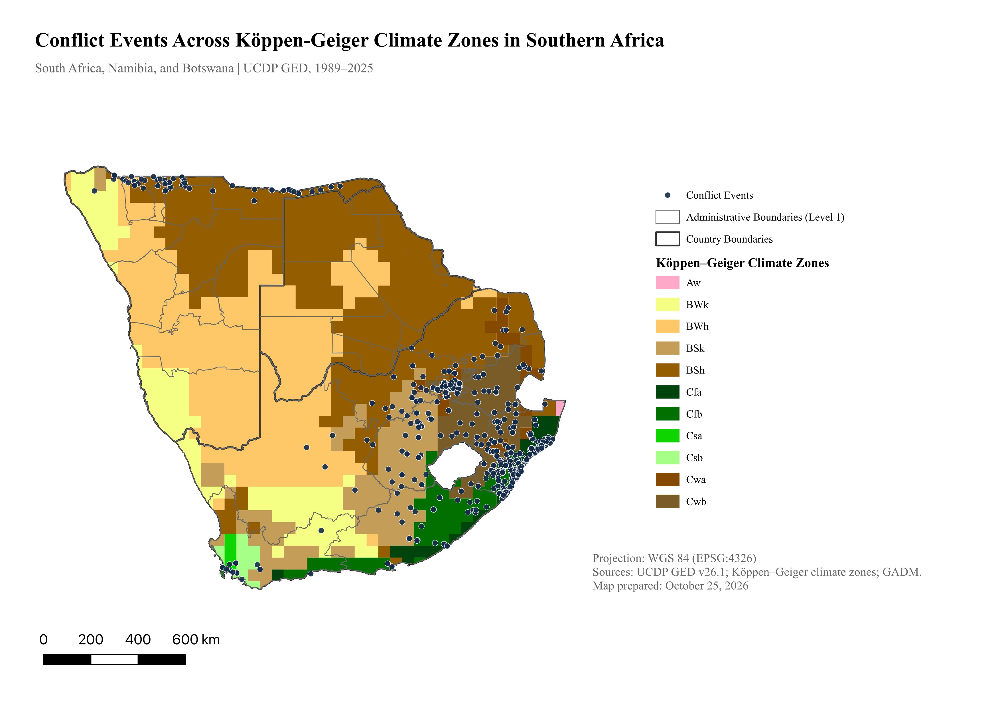

# Conflict Events Across Climate Zones in Southern Africa

A spatial analysis and cartographic project completed for **GPEC 443**, examining recorded conflict events across Köppen–Geiger climate zones in **South Africa, Namibia, and Botswana**.



## Project overview

How are recorded conflict events distributed across the contrasting climate zones of Southern Africa? This project combines R-based data preparation with QGIS spatial analysis to explore this question in South Africa, Namibia, and Botswana, with South Africa as the focal case.

South Africa offers a distinctive setting because its climate geography intersects with persistent spatial inequalities rooted in apartheid. Unequal access to land, employment, and services provides an important social context for interpreting the geography of violence, although these factors are not directly tested in this project (World Bank, 2022). Neighboring Namibia and Botswana extend the study across a contiguous regional landscape, placing South Africa’s patterns alongside neighboring climate zones and different national contexts. They provide regional context rather than a controlled comparison.

The study is informed by research showing that relationships between climate and conflict depend on socioeconomic and political conditions rather than a simple, direct environmental mechanism (Koubi, 2019). It maps 2,928 UCDP GED events spanning 1989–2025 and summarizes their distribution across Köppen–Geiger climate zones. Of these records, 2,908 are in South Africa, 19 in Namibia, and 1 in Botswana, so the analysis primarily describes South African patterns within a broader regional setting.

This is an exploratory analysis of spatial distributions. Köppen–Geiger zones describe climate regimes rather than changes in climate over time, and raw event counts are not adjusted for population or land area. The results therefore do not establish that climate or climate change causes conflict.

## Methods and skills

- Filtered conflict-event data by country using R, `readr`, and `dplyr`.
- Checked coordinate completeness and exported individual event records for QGIS.
- Combined administrative boundaries, climate zones, and conflict-event locations.
- Used spatial overlays and aggregation to summarize events by climate zone.
- Designed a map with a legend, scale bar, geographic context, and source attribution.

## Selected results

| Climate zone | Recorded events |
|---|---:|
| Cfa — Temperate, no dry season, hot summer | 1,242 |
| Cwb — Temperate, dry winter, warm summer | 825 |
| Cfb — Temperate, no dry season, warm summer | 412 |

The dataset is dominated by events recorded in South Africa: 2,908 records, compared with 19 in Namibia and 1 in Botswana.

These descriptive counts are not adjusted for population, land area, or reporting coverage and do not establish a causal relationship between climate and conflict. The summary tables list climate zones with recorded events. The map legend also includes Aw, which is absent from the summary tables; whether to include an explicit zero row remains to be confirmed.

## Repository contents

- `maps/`: Final map export.
- `code/`: R scripts for country filtering, coordinate checks, and event export.
- `data/processed/`: Climate-zone summary tables.
- `qgis/`: Original QGIS project file and dependency notes.
- `DATA_SOURCES.md`: Source provenance, publication status, and required local inputs.

## Reproducibility

Install `readr` and `dplyr`, then run the scripts from this project directory:

```r
source("code/02_filter_conflict_data.R")
source("code/03_export_conflict_points.R")
```

Both scripts expect the original conflict dataset at `data/raw/GEDEvent_v26_1.csv`. Script 03 writes `data/processed/conflict_points_3countries.csv` and validates the expected 2,928 records. The source dataset and event-level export are excluded from this portfolio package.

The R scripts cover event preparation. Spatial overlays, aggregation, and map layout were completed in QGIS and are not automated by these scripts. The included QGIS project requires external files and path repair; see [QGIS dependency notes](qgis/README.md).

## Data sources and publication status

- **Conflict events:** UCDP Georeferenced Event Dataset (GED), version 26.1, covering **1989–2025**. UCDP data are available under [CC BY 4.0](https://creativecommons.org/licenses/by/4.0/). See the [UCDP Download Center](https://ucdp.uu.se/downloads/) for data and recommended citations.
- **Climate classification:** Köppen–Geiger climate zones for the **1976–2000 baseline period**, corresponding to the dataset distributed through the [World Bank Data Catalog](https://datacatalog.worldbank.org/search/dataset/0042325/world-maps-of-the-k-ppen-geiger-climate-classification), which lists it under CC BY 4.0. Comparison with the public download found matching attributes and per-feature vertex-coordinate sets, with differences in geometry organization and coordinate-reference metadata. This establishes a strong data match, rather than a documented history of the local file's processing.
- **Administrative boundaries:** GADM version 4.1. Original boundary datasets are not redistributed here. See the [GADM license](https://gadm.org/license.html) for applicable terms.

The climate layer represents a historical climate baseline, not annual climate conditions during the conflict observation period. Original source datasets and intermediate spatial layers are excluded. Third-party materials retain their respective license terms.

**Climate data reference:** Rubel, F., & Kottek, M. (2010). Observed and projected climate shifts 1901–2100 depicted by world maps of the Köppen–Geiger climate classification. *Meteorologische Zeitschrift, 19*, 135–141. https://doi.org/10.1127/0941-2948/2010/0430

**UCDP GED reference:** Sundberg, R., & Melander, E. (2013). Introducing the UCDP Georeferenced Event Dataset. *Journal of Peace Research, 50*(4), 523–532. https://doi.org/10.1177/0022343313484347

See [DATA_SOURCES.md](DATA_SOURCES.md) for additional source and dependency notes.
